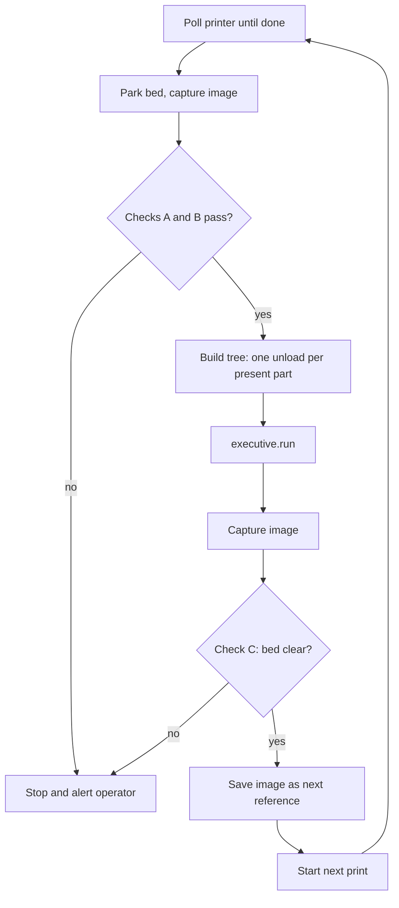

# 3D Printer Unloading with OMTS: Feasibility Study

A robot that unloads a 3D printer when a print finishes is viable on top of
OMTS. Most of the software carries over; the hard problems are physical.

> [!NOTE]
> Revised against `main` at `48be90d` (#151). Since the first draft, OMTS
> split grasp planning from localization (`GraspPlannerInterface`, with
> `cuboid_center` and `moveit` backends), replaced `RobotInterface`/`UrRobot`
> with a single vendor-neutral `Robot`, and added `Touchdown` and
> `create_seated_approach_tasks`. Each of these simplifies the printer design;
> the affected sections below say how.
>
> Later revision: force sensing is **no longer a requirement**, so that low-cost
> position-controlled arms qualify. Sections 4, 5 and 6 reflect that, and
> section 7 evaluates the SO-101 as a low-cost arm.

---

## 1. Summary

The goal is an open-source prototype that is as accessible as possible. The
proposed design follows from that:

* **Localize parts from the slicer's plate layout, not vision.** The 3MF
  project already says where each part is, its orientation and its height. One
  calibrated bed frame maps that into the robot world.
* **Verify with a plain RGB camera**, ideally the one the printer already has.
  Comparing the image against an empty-bed reference confirms parts are present
  and the bed is clear. No depth camera, pose estimator or trained model is
  needed.
* **No force sensing.** The robot moves to the grasp height known from the 3MF
  under position control, with compliant fingertips absorbing small Z errors.
  Any position-controlled arm qualifies.
* **Run the cycle from a host-side loop.** Each print job gets its own behavior
  tree: wait for done, check the bed, unload, check the bed again, start the
  next job.
* **Low-cost arm path:** an SO-101 (~$230 pair) connected to ICON through
  Intrinsic's `ros2_control` bridge (section 7), pending a feasibility spike.

The main open risks are removing prints from the bed (sheet swap vs. direct
grasp), low-contrast part and sheet combinations for the camera, and the
SO-101's reach and accuracy.

---

## 2. What Carries Over from OMTS

Robot motion, the gripper, collision rules, config loading and the
behavior-tree scaffolding transfer almost unchanged. The new work is a printer
adapter, a different cycle shape and a new cell configuration.

| OMTS component | Reuse | Change needed |
| --- | --- | --- |
| [`robot.py`](../src/hardware/robot.py) (`Robot`) | As is | None. `Robot` wraps vendor-neutral skills and binds to any ICON-controlled arm, including one bridged from `ros2_control` (section 7). |
| [`gripper.py`](../src/hardware/gripper.py) `GripperInterface` | As is for UR + Hand-E | An SO-101 needs a new implementation that drives its gripper servo as a joint (section 7). |
| [`motions.py`](../src/behaviors/motions.py): `create_seated_approach_tasks` + `Touchdown` | Adapted | Standoff approach → touchdown → retract is the bed-pick shape, but touchdown uses `move_to_contact`, which needs a force-torque sensor. Without force sensing, the touchdown step becomes a slow position-only move to the known Z. |
| [`grasping.py`](../src/hardware/grasping.py) `GraspPlannerInterface` + [`grasp_planners.py`](../src/hardware/grasp_planners.py) factory | Extended | Add a plate-layout backend next to `cuboid_center` and `moveit` (section 4.4). |
| [`pick.py`](../src/behaviors/pick.py) | Adapted | Becomes the "pick from bed" subtree. Its guard that a grasp planner requires perception infeed must also admit plate-layout localization. |
| [`unload_machine.py`](../src/behaviors/unload_machine.py), [`return_infeed.py`](../src/behaviors/return_infeed.py) | Small changes | "Return to infeed" becomes "place at outfeed". Use a deterministic `Tray` grid rather than `return_shift`: random placement can drop a part onto one placed earlier. |
| [`machining.py`](../src/behaviors/machining.py) | Shape fits | Close door, start, wait for done is the same handshake a printer needs. It now assumes the arm is already at standby. |
| [`load_machine.py`](../src/behaviors/load_machine.py) | Dropped | The printer makes the part, so there is nothing to load. |
| `CncMachineInterface` ([`machine.py`](../src/hardware/machine.py)) | Re-implemented | Door / vise / cycle maps to door / bed / print job. |
| [`dynamic_frame_calculator.py`](../src/utils/dynamic_frame_calculator.py) | Pattern reused | Compose the part pose with the bed frame instead of the camera frame. It already separates the workpiece pose update from grasp-frame publishing (`publish_grasp_frames`). |
| `//:setup` flag and `configs/<cell>/` | New cell | `configs/printer/`, a printer model, and frames such as `bed_approach`, `bed_view`, `outfeed`. |
| Orbbec, FoundationPose, RF-DETR, inference service | Not needed | Currently wired into `//:omts_solution` unconditionally; a printer cell should `select()` them out. |

---

## 3. Key Challenges

### 3.1 Detecting that the print is finished

Printers report status over HTTP or MQTT (Moonraker/Klipper, OctoPrint,
PrusaLink, Bambu LAN MQTT), not over discrete I/O.

OMTS also has a gap here, still present on `main`: the solution declares
`dio_read_input` but not
`dio_wait_for_input`. `DioCncMachine.build_wait_cycle_complete_task` therefore
falls back to "sleep N seconds, then read once", and nothing acts on the value
read. It does not actually wait for the signal.

| Option | Effort | Trade-off |
| --- | --- | --- |
| **DIO bridge**: end G-code (`M42` / Klipper `SET_PIN`) raises a pin wired to a UR digital input | Lowest, if the board has a spare GPIO | Keeps `DioCncMachine`; needs a real wait-for-input (add the skill or a retry loop). |
| **Host-side polling**: `main.py` polls the printer API, then calls `executive.run(tree)` once per job | Low, pure software | Moves the loop from `bt.Loop` into Python, changing the "one tree, one run" design. |
| **Custom skill** that polls the printer API | Highest | Cleanest long term; needs a skill asset and network access from the cluster to the printer. |

The plate-layout approach (section 4) needs a new tree per job anyway, which
makes **host-side polling** the natural fit.

### 3.2 Getting the print off the bed

Prints stick to the bed, sometimes very hard. In order of robustness:

1. **Sheet swap (recommended).** The robot removes the magnetic spring-steel
   sheet, places it on a flex/release station or in a rack, and installs a
   fresh one. The robot always grasps the same rigid object at a known frame,
   which matches the OMTS approach-then-grasp pattern and removes per-part
   grasp planning.
2. **Cool down, then grasp.** PEI usually releases below about 35 °C. Add a
   bed-temperature condition before entering. Success still depends on part
   geometry and adhesion.
3. **Push off with G-code.** The toolhead sweeps parts into a bin. No robot
   needed, but part orientation is lost.

The rest of this document assumes direct part grasping (option 2), since it is
the harder case; sheet swap reuses most of the same pieces.

### 3.3 Every part is different

The OMTS vision path uses FoundationPose with an estimator registered for one
known object. Registering an estimator per print job adds a training step to
every cycle. Section 4 replaces vision with the slicer's plate layout. The
Hand-E's 50 mm stroke and pinch fingers also cap part size and shape.

### 3.4 Access, safety and the world model

* The printer must be in a known state before the robot enters: gantry parked,
  bed at a fixed Z, steppers idle. Bed Z can be modelled as a joint, like the
  vise jaws, and synced with `update_world`.
* Enclosed printers (Bambu, Prusa Core One) have manual doors: remove the door
  or add an actuator, which then maps onto the existing door logic.
* The printer knows nothing about the robot. No job may start while the arm is
  inside. Robot-side start control is enough for a prototype; beyond that, a
  real interlock is needed.
* Hot nozzles and beds during approach.

### 3.5 Simulation

A printer `.glb` and Gazebo model are needed before simulation runs
(`--operation_mode=sim` at deploy time, `--simulation_mode=fast_preview` in the
app) are useful.

---

## 4. Part Localization from the Slicer Plate Layout

The slicer already knows where every part sits on the bed, its orientation and
its shape. Mapping slicer coordinates into the robot's `root` frame reduces
localization to one calibrated transform plus file parsing. The OMTS pick flow
keeps its shape (pre-grasp, approach, grasp, retract), with the touchdown
replaced by a position-only approach.

### 4.1 Data sources

| Source | Provides | Caveats |
| --- | --- | --- |
| **3MF project** (`3D/3dmodel.model`) | Each `<build><item>` has a 12-value `transform` (3×4 affine, mm) plus the object mesh: XY, Z rotation, footprint, height. | Slicer bed coordinates may be offset from firmware coordinates. Bambu/Orca add per-plate metadata (`Metadata/plate_N.json`, `model_settings.config`). |
| **Klipper `exclude_object`** (Moonraker `printer.objects.query?exclude_object`) | `objects[]` with `name`, `center`, `polygon` (convex hull) in firmware coordinates, plus `excluded_objects` cancelled mid-print. | Needs "label objects" enabled in the slicer. No height, no mesh. |
| **G-code parsing** | First-layer footprint and max Z per labelled object. | Works on any firmware, but the most effort. |

**Recommendation:** the app starts each print, so it already holds the 3MF it
sent. Use the 3MF for geometry and grasps. On Klipper, also read
`excluded_objects` at runtime so cancelled (failed) objects are skipped.

### 4.2 Transform chain and calibration

```
root_T_part = root_T_bed      (calibrated once; a named frame in scene.updates.pbtxt)
            · bed_T_slicer    (fixed slicer → firmware origin offset; often identity)
            · slicer_T_part   (3MF item transform, mm → m)
```

* **Calibrating `root_T_bed`.** Print a calibration plate once, for example
  three cones at known slicer XY. Touch each cone tip with the TCP using the
  jogging tools, then fit a rigid transform to the three or more points. Because
  this runs through the real slicer → firmware → sheet chain, it captures every
  offset at once. Store the result as a `print_bed` frame, like `vise_place`.
* **Bed position.** Must be deterministic at end of print: an explicit move in
  the end G-code (`G1 Z<fixed>` on a Z-bed CoreXY, `G1 Y<park>` on a
  bed-slinger), or read `toolhead.position` and sync a bed joint.

### 4.3 Error budget

| Source | Typical error |
| --- | --- |
| Printer XY | ~0.1 mm |
| Spring sheet on its pins | ~0.2–0.5 mm |
| Bed calibration | ~0.5 mm |
| Arm: UR repeatability | ~0.03 mm |
| Arm: SO-101 (estimate, section 7) | ~±3–5 mm |

With a UR the total is roughly ±1 mm, well within what a parallel gripper
tolerates: closing the jaws self-centres the part along the jaw axis. With an
SO-101 the arm dominates at about ±5 mm, which still works for most parts but
needs wider grasp margins and looser camera thresholds.

Without force sensing, Z error is not absorbed by a touchdown. Grasp depth
keeps a margin above the bed, and compliant fingertips (printed in TPU) take up
the rest.

### 4.4 Grasp planning

OMTS now keeps localization and grasp planning separate. Localization puts the
part's pose into the Object World. A `GraspPlannerInterface` backend then
writes the `grasp` and `pre_grasp` frames that the pick subtree approaches. The
plate layout is a **localization source** that replaces perception. Grasp
planning is a separate choice:

| Backend | How it chooses the grasp | Extra dependencies | Fit for printed parts |
| --- | --- | --- | --- |
| **Plate footprint** (new) | Host-side, from the 3MF mesh (steps below). Its `build_plan_grasp_task` writes the precomputed frames. | None | Default. Box-like and prismatic parts. |
| `cuboid_center` (existing) | Centre of the part, jaws along the short side. Lives inside the perception frame calculator. | None | Logic is reusable, but it is tied to the perception pipeline today. |
| `moveit` (existing, optional) | Samples grasp candidates over the part's faces in the Object World, checks IK and collisions with MoveIt Task Constructor. | ROS 2 workspace with `intrinsic-moveit` and a running planning service | Complex geometry. Configure `moveit_surfaces` so no candidate approaches through the bed. |

The MoveIt backend plans against neighbouring parts and the printer frame
automatically, which the footprint planner approximates by hand. Because it
needs a ROS 2 setup, it stays optional to keep the default install accessible.

Plate footprint planner, for each part:

1. Transform the mesh into bed coordinates; take its height `h` and the
   cross-section near the grasp height.
2. Fit a minimum-area rectangle (rotating calipers) to get width, length and
   yaw.
3. Put the jaw axis along the narrow side; reject the part if it doesn't fit
   the 50 mm stroke with margin.
4. Grasp depth: `z_grasp = min(h − margin, finger_length − margin)`.
5. Check finger clearance against neighbouring parts' footprints.
6. Pick order: sweep in one direction so the fingers never pass over parts
   still on the bed.

Parts that fail are marked "ungraspable" and left on the sheet. Running the
same checks as a **pre-print validation** step rejects bad layouts before
printing, so every accepted layout is pickable.

The bed pick then follows the `create_seated_approach_tasks` pattern: approach
a standoff above the expected part top, then a slow linear move to
`z_grasp` instead of `move_to_contact`, then grasp and retract.

---

## 5. Presence Verification with an RGB Camera

The plate layout says where parts *should* be, not whether they *are* there. A
plain RGB image compared against an empty-bed reference answers that.

A depth camera was considered first and dropped: it conflicts with the goal of
an accessible open-source project. With force sensing also dropped, part height
is not measured at all (section 5.5).

### 5.1 Checks

| Check | When | Logic | Catches |
| --- | --- | --- | --- |
| **A. Part present** | Before unload | Each projected part region differs from the reference. | Missing part, failed print |
| **B. Nothing unexpected** | Before unload | No change outside the expected part regions (enlarged by a few mm). | Knocked-over parts, spaghetti, debris |
| **C. Bed clear** | After unload | No change anywhere on the sheet. | Stuck parts, failed grasps, leftovers that would crash the next print |

Check B matters because a knocked-over part may lie in a neighbour's
finger-clearance zone that the belief world thinks is empty. Force sensing
cannot catch that; the camera can.

### 5.2 Camera source

| Source | Cost | Notes |
| --- | --- | --- |
| **Printer's existing camera** via HTTP snapshot | $0 | Moonraker (crowsnest) and OctoPrint expose a JPEG snapshot URL. Vendor cameras vary: Bambu works over LAN with less standard protocols; Prusa's camera is built around Prusa Connect. |
| **USB webcam** on a fixed printer mount | ~$20 | Read with OpenCV `VideoCapture`. Can check the bed while the robot waits at standby. |
| Robot-wrist RGB camera | Varies | Not recommended: needs a mount and only works with the arm in position. |

Images are taken **outside Intrinsic**, in plain Python on the host. The check
then has no dependency on an Intrinsic camera driver, and saved images make it
fully testable in `tests/unit`. `numpy` and `opencv-python-headless` are
already pinned in `third_party/foundationpose/requirements.txt`; the app would
likely get its own smaller requirements file.

### 5.3 Bed-to-pixel calibration (no depth, no intrinsics)

* **Homography (4 points), minimum.** Click the sheet corners once, or print
  four markers at known slicer XY. Maps bed millimetres to pixels at bed level;
  enough for checks A and C.
* **3×4 projection matrix (≥ 6 points at varied heights), recommended.** Add
  pillars of known heights to the calibration print and fit a Direct Linear
  Transform (DLT). This projects each part's footprint-plus-height shape, which
  matters for tall parts seen at an angle (check B).

The same calibration print calibrates the robot (cone tips touched by the TCP)
and the camera (the same features in the image). No camera model or
checkerboard is needed.

### 5.4 Robust differencing

* **Self-updating reference.** Capture the bed right before each print starts,
  after check C confirms it is clear. That image is the empty reference for the
  print's end. It follows sheet swaps, lighting drift and sheet wear.
* **Lock exposure and white balance**, and use the enclosure light for both
  captures.
* **Compare structure, not raw colour**: local SSIM or gradient differences
  instead of pixel subtraction.
* **Low contrast is the main failure case** (black PLA on a black textured
  sheet). Mitigate with a contrasting sheet or low-angle side lighting;
  document as a known limitation.

### 5.5 What RGB cannot do, and how it is covered

| Capability | RGB camera | Covered by |
| --- | --- | --- |
| Part present / absent | Yes | — |
| Unexpected object on bed | Yes, within contrast limits | — |
| Bed clear after unload | Yes | — |
| Collapsed or short print | No | **Not covered (accepted gap).** Without force sensing, nothing measures part height. If the part is much shorter than planned, the jaws close above it and the empty-grasp check catches it. |
| Part stuck to the sheet | No | Check C after unload: the part is still on the bed. |
| Empty grasp | No | Final finger position. The SO-101 gripper reports it as a joint state; `RobotiqGripper` does not expose it today. |

---

## 6. Proposed Code Changes

| New piece | Layer | Notes |
| --- | --- | --- |
| `src/core/plate_layout.py` | core | Parse the 3MF with stdlib `zipfile` + `xml.etree`; returns `PlatePart(name, bed_T_part, footprint, height)`. Testable with a fixture 3MF. |
| `src/core/footprint_grasp.py` | core | Minimum-area rectangle, stroke and clearance checks, pick order. Pure math. |
| `PlateGraspPlanner` + `GraspPlannerType.PLATE_FOOTPRINT` | hardware | `GraspPlannerInterface` backend that writes the precomputed frames; registered in `grasp_planners.py`. |
| `PlateLayoutInfeedStrategy` + `InfeedMode.PLATE` | core | Next to `GridInfeedStrategy`, which today uses static frames. `pick.py` must accept it as a localization source for grasp planning. |
| Position-only approach | behaviors | A variant of `create_seated_approach_tasks` (or a `Touchdown` setting) that replaces `move_to_contact` with a slow linear move to the planned Z. |
| SO-101 bring-up | deployment | `icon_hwm_controller` + a Feetech `ros2_control` driver, an SO-101 hardware device asset, and a joint-driven `GripperInterface` (section 7). |
| `src/core/bed_check.py` | core | Homography/DLT projection and image differencing for checks A–C. Pure numpy/OpenCV. |
| `plate_frame_calculator.py` | utils | Variant of `dynamic_frame_calculator.py`: `root_T_bed` from the live world × bed→part pose passed as params. Stdlib and `intrinsic.*` imports only. |
| `PrinterInterface` adapter | hardware | Status polling, start job, bed park. Replaces `CncMachineInterface` for this cell. |
| `PlateConfig`, `print_bed` and `bed_view` frames | config | Bed frame, slicer → firmware offset, grasp margins, finger geometry, camera source. |
| Per-part object names | behaviors | Collision pairs assume one `config.cycle.workpiece_id`; a plate with N parts needs a name per part and each part in the world (at least as a bounding box). |
| Printer cell in `//:setup` | BUILD | `select()` out Orbbec, FoundationPose, RF-DETR and inference service. |

### 6.1 Per-job cycle

The tree is **built per print job**, with one pick sequence unrolled per part,
instead of `bt.Loop` repeating a fixed cycle:



---

## 7. Low-Cost Arm: SO-101

The UR arm and Robotiq Hand-E are a far bigger cost barrier than any camera.
The [SO-101](https://github.com/TheRobotStudio/SO-ARM100) is an open-source,
3D-printed arm at about $230 for a leader + follower pair. It is viable for a
prototype if the bed comes to the arm, but it reaches ICON only through a ROS 2
bridge that still needs a feasibility spike.

### 7.1 Arm drivers available from Intrinsic

| Route | Arms | Fit |
| --- | --- | --- |
| Native ICON hardware modules (`intrinsic-core`) | UR3e/5e/10e, KUKA KR6–KR50 (RSI), ABB IRB 1300 | Industrial only; no low-cost arm. |
| [Flowstate catalog](https://flowstate.intrinsic.ai/docs/assets/assets_catalog/hardware_assets/robot/) | Adds UR16e/UR20 and more FANUC/KUKA models | Industrial only. |
| **[`icon_hwm_controller`](https://github.com/intrinsic-ai/icon-hwm-controller)** (ROS 2 bridge) | Any arm with a `ros2_control` driver; examples for FANUC, Kawasaki, UR | Joint position commands and position/velocity state only; no force-torque, no I/O; ICON's rate must match the driver's; targets ROS 2 Kilted on Ubuntu 24.04. |
| Custom C++ hardware module (`strawbot` template in `intrinsic-core`) | Anything | Last resort: real-time C++ work, roughly weeks. |

Intrinsic's own bring-up tutorial recommends the bridge for unsupported robots
(`developer_resources/learn/tutorials/interactive_tutorials/icon/ros2_bridge_tutorial.md`
in `intrinsic-core`). With force sensing dropped, only its lack of I/O remains a
limitation, and that does not block a prototype.

### 7.2 SO-101 capabilities

| Property | Value | Source |
| --- | --- | --- |
| Joints | 5 arm joints + 1 gripper servo | URDF |
| Max reach | 0.47 m from the base rotation joint | Forward kinematics on the URDF |
| Top-down reach | 0.32 m max; about 0.07–0.30 m at bed level | Forward kinematics on the URDF |
| Servos | Feetech STS3215, 12-bit encoder (0.088°), ≤0.5° gear backlash | [Vendor listing](https://eckstein-shop.de/feetech-sts3215-so-arm101-servomotor-7v4-14kgcm-360grad-magnetencoder_1) |
| Accuracy | ~±3–5 mm (estimate: 0.5° backlash at 0.3 m, plus link flex; not measured) | Derived |
| Payload | ~500 g claimed, pose-dependent | [roboticscenter.ai](https://roboticscenter.ai/hardware/so-101/specs) (unsourced) |
| Gripper | Single pivoting jaw, −10° to 100° | URDF |

The reach figures come from sampling the joint limits in
[`so101_new_calib.urdf`](so101_new_calib.urdf) (from the SO-ARM100 repo). The
~500 mm figure quoted by third-party spec pages is the full stretch; top-down
grasps, which bed picking needs, top out at 0.32 m.

**What works**

* **Top-down grasps at any yaw.** The bending joints are parallel and the last
  joint rolls about the approach axis, so "pointing straight down, any yaw" is
  fully reachable with 5 joints. `Robot` already has a goal mode that
  constrains only position and pointing direction (`allow_tool_z_rotation`).
* **Payload.** Typical prints weigh tens of grams.
* **No force sensing needed** under the revised requirements.

**Risks**

1. **Reach vs. bed size.** A 256 mm-deep bed needs pick radii of about
   0.08–0.34 m, just beyond the arm. It works only with a bed-slinger parked
   toward the arm (Prusa MK4, Bambu A1) or with the arm beside the bed,
   sweeping it in an arc. Reaching into an enclosed CoreXY printer is unlikely.
2. **Accuracy.** About ±5 mm overall (section 4.3) means wider grasp margins,
   looser camera thresholds, and slow final approaches.
3. **Gripper.** A pivoting jaw does not self-centre the way the Hand-E does.
   The footprint planner needs a different contact model, and the opening
   width still has to be measured.
4. **Bridge unknowns.** Whether a Feetech driver builds on Kilted, what control
   rate the servo bus sustains, and whether ICON accepts that rate. The bridge
   has no I/O, so the gripper servo must be bridged as a 6th joint and driven
   by a new `GripperInterface` implementation.
5. **5-joint planning.** Nothing found in `intrinsic-core` excludes it, but
   every OMTS goal must be top-down; a full `PoseEquality` goal with tilt will
   be unreachable.
6. **Real-time PC.** ICON real mode still needs a real-time Linux PC with k3s,
   which offsets part of the arm's cost advantage.

### 7.3 Existing `ros2_control` drivers

* [`ros-physical-ai/feetech_ros2_driver`](https://github.com/ros-physical-ai/feetech_ros2_driver):
  generic Feetech `ros2_control` hardware interface, BSD-3; fork of
  [JafarAbdi/feetech_ros2_driver](https://github.com/JafarAbdi/feetech_ros2_driver).
* SO-101-specific interfaces:
  [`so101-ros2`](https://so101-ros2.readthedocs.io/latest/ros2controlarch.html),
  [`Lerobot_ros2`](https://github.com/AgRoboticsResearch/Lerobot_ros2).

The intended stack is: SO-101 → Feetech `ros2_control` driver →
`icon_hwm_controller` → ICON → OMTS `Robot`.

---

## 8. Prototype Plan and Open Questions

### 8.1 Suggested order

1. `plate_layout.py` + `footprint_grasp.py` with unit tests against real 3MFs.
   Pure Python, no hardware; shows how many typical plates are pickable.
2. Confirm the camera path: pull one snapshot from the printer's camera (or a
   USB webcam) and run check C against a saved reference.
3. SO-101 spike: deploy `icon_hwm_controller` with a Feetech `ros2_control`
   driver and run one OMTS `Robot` move. In parallel, check bed coverage in
   simulation with the URDF.
4. Calibration print: fit `root_T_bed` and the bed-to-pixel projection from the
   same features.
5. Printer adapter: status polling, done signal, start job, bed park.
6. Printer cell config, scene model and per-job tree; first runs in
   simulation, then on hardware.

### 8.2 Open questions

* Which printer and firmware are targeted? This decides the status API, the
  camera source, which 3MF variant to parse and, for the SO-101, whether the
  bed is reachable at all.
* Sheet swap or direct part grasping?
* Does the SO-101 bridge spike work (driver on Kilted, achievable control
  rate)? If not, the fallback is a custom hardware module or a UR arm.
* Is the uncovered "collapsed or short print" case acceptable, or does it need
  another check?
* Is the MoveIt grasp backend worth its ROS 2 setup cost for printed parts,
  or is the footprint planner enough for the target part mix?
