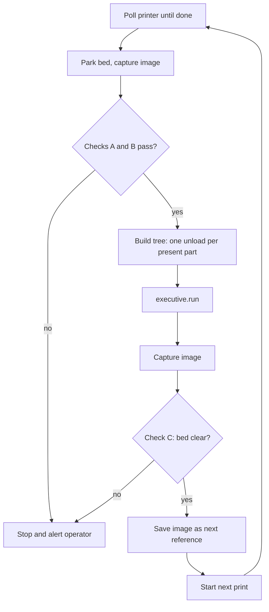

# 3D Printer Unloading: Design Notes

Printer-side design for the steps after milestone 1: detecting a finished
print, localizing parts from the slicer's plate layout, planning grasps, and
checking the bed with a camera. Decisions, the plan and open questions are in
[`HANDOFF.md`](HANDOFF.md) (section 3.2 summarizes the decisions taken here);
the arm choice is in [`ARM_SELECTION_REQUEST.md`](ARM_SELECTION_REQUEST.md).
Earlier versions of this file, including the SO-101 evaluation, are in git
history (commit `6b33ad7`).

---

## 1. Detecting That the Print Is Finished

Printers report status over HTTP or MQTT (Moonraker/Klipper, OctoPrint,
PrusaLink, Bambu LAN MQTT), not over discrete I/O.

| Option | Effort | Trade-off |
| --- | --- | --- |
| **DIO bridge**: end G-code (`M42` / Klipper `SET_PIN`) raises a pin wired to an arm digital input | Lowest, if the board has a spare GPIO | Keeps `DioCncMachine`, but it needs a real wait-for-input first (`HANDOFF.md` section 8). |
| **Host-side polling**: the app polls the printer API, then calls `executive.run(tree)` once per job | Low, pure software | Moves the loop from `bt.Loop` into Python, changing the "one tree, one run" design. |
| **Custom skill** that polls the printer API | Highest | Cleanest long term; needs a skill asset and network access from the cluster to the printer. |

Plate-layout localization (section 4) needs a new tree per job anyway, which
makes **host-side polling** the natural fit.

## 2. Getting the Print off the Bed

Prints stick to the bed, sometimes very hard. In order of robustness:

1. **Sheet swap.** The robot removes the magnetic spring-steel sheet, places it
   on a flex/release station or in a rack, and installs a fresh one. The robot
   always grasps the same rigid object at a known frame, so no per-part grasp
   planning is needed.
2. **Cool down, then grasp.** PEI usually releases below about 35 °C. Add a
   bed-temperature condition before entering. Success still depends on part
   geometry and adhesion.
3. **Push off with G-code.** The toolhead sweeps parts into a bin. No robot
   needed, but part orientation is lost.

The rest of this document assumes direct part grasping (option 2), since it is
the harder case; sheet swap reuses most of the same pieces. The choice is open
(`HANDOFF.md` 4.2).

## 3. Printer Access and Safety

* The printer must be in a known state before the robot enters: gantry parked,
  bed at a fixed Z, steppers idle. Bed Z can be modelled as a joint, like the
  CNC vise jaws, and synced with `update_world`.
* Enclosed printers (Bambu, Prusa Core One) have manual doors: remove the door
  or add an actuator, which then maps onto the existing door logic.
* The printer knows nothing about the robot. No job may start while the arm is
  inside. Robot-side start control is enough for a prototype; beyond that, a
  real interlock is needed.
* Hot nozzles and beds during approach.

---

## 4. Part Localization from the Slicer Plate Layout

The slicer already knows where every part sits on the bed, its orientation and
its shape. Mapping slicer coordinates into the robot's `root` frame reduces
localization to one calibrated transform plus file parsing, with no
per-job pose-estimator training.

### 4.1 Data sources

| Source | Provides | Caveats |
| --- | --- | --- |
| **3MF project** (`3D/3dmodel.model`) | Each `<build><item>` has a 12-value `transform` (3×4 affine, mm) plus the object mesh: XY, Z rotation, footprint, height. | Slicer bed coordinates may be offset from firmware coordinates. Bambu/Orca add per-plate metadata (`Metadata/plate_N.json`, `model_settings.config`). |
| **Klipper `exclude_object`** (Moonraker `printer.objects.query?exclude_object`) | `objects[]` with `name`, `center`, `polygon` (convex hull) in firmware coordinates, plus `excluded_objects` cancelled mid-print. | Needs "label objects" enabled in the slicer. No height, no mesh. |
| **G-code parsing** | First-layer footprint and max Z per labelled object. | Works on any firmware, but the most effort. |

**Recommendation:** the app starts each print, so it already holds the 3MF it
sent. Use the 3MF for geometry and grasps. On Klipper, also read
`excluded_objects` at runtime so cancelled (failed) objects are skipped.

### 4.2 Transform chain and calibration

```
root_T_part = root_T_bed      (calibrated once; a named frame in scene.updates.pbtxt)
            · bed_T_slicer    (fixed slicer → firmware origin offset; often identity)
            · slicer_T_part   (3MF item transform, mm → m)
```

* **Calibrating `root_T_bed`.** Print a calibration plate once, for example
  three cones at known slicer XY. Touch each cone tip with the TCP using the
  jogging tools, then fit a rigid transform to the three or more points. Because
  this runs through the real slicer → firmware → sheet chain, it captures every
  offset at once. Store the result as a `print_bed` frame, like `vise_place`.
* **Bed position.** Must be deterministic at end of print: an explicit move in
  the end G-code (`G1 Z<fixed>` on a Z-bed CoreXY, `G1 Y<park>` on a
  bed-slinger), or read `toolhead.position` and sync a bed joint.

### 4.3 Error budget

| Source | Typical error |
| --- | --- |
| Printer XY | ~0.1 mm |
| Spring sheet on its pins | ~0.2–0.5 mm |
| Bed calibration | ~0.5 mm |
| Arm: reBot B601-RS repeatability | < 0.2 mm (vendor claim, not measured) |

The total is roughly ±1 mm if the reBot's figure holds, well within what a
parallel gripper tolerates: closing the jaws self-centres the part along the
jaw axis. The reBot's fingers are driven 1:1 by one pinion (`HANDOFF.md` 6.2),
so they self-centre.

Without force sensing, Z error is not absorbed by a touchdown. Grasp depth
keeps a margin above the bed, and compliant fingertips (printed in TPU) take up
the rest.

### 4.4 Grasp planning

OMTS keeps localization and grasp planning separate. Localization puts the
part's pose into the Object World. A `GraspPlannerInterface` backend then
writes the `grasp` and `pre_grasp` frames that the pick subtree approaches. The
plate layout is a **localization source** that replaces perception. Grasp
planning is a separate choice:

| Backend | How it chooses the grasp | Extra dependencies | Fit for printed parts |
| --- | --- | --- | --- |
| **Plate footprint** (new) | Host-side, from the 3MF mesh (steps below). Its `build_plan_grasp_task` writes the precomputed frames. | None | Default. Box-like and prismatic parts. |
| `cuboid_center` (existing) | Centre of the part, jaws along the short side. Lives inside the perception frame calculator. | None | Logic is reusable, but it is tied to the perception pipeline today. |
| `moveit` (existing, optional) | Samples grasp candidates over the part's faces in the Object World, checks IK and collisions with MoveIt Task Constructor. | ROS 2 workspace with `intrinsic-moveit` and a running planning service | Complex geometry. Configure `moveit_surfaces` so no candidate approaches through the bed. |

The MoveIt backend plans against neighbouring parts and the printer frame
automatically, which the footprint planner approximates by hand. Because it
needs a ROS 2 setup, it stays optional to keep the default install accessible.

Plate footprint planner, for each part:

1. Transform the mesh into bed coordinates; take its height `h` and the
   cross-section near the grasp height.
2. Fit a minimum-area rectangle (rotating calipers) to get width, length and
   yaw.
3. Put the jaw axis along the narrow side; reject the part if it doesn't fit
   the gripper's opening with margin (the reBot opens to about 100 mm).
4. Grasp depth: `z_grasp = min(h − margin, finger_length − margin)` (reBot
   fingers are about 50 mm long).
5. Check finger clearance against neighbouring parts' footprints.
6. Pick order: sweep in one direction so the fingers never pass over parts
   still on the bed.

Parts that fail are marked "ungraspable" and left on the sheet. Running the
same checks as a **pre-print validation** step rejects bad layouts before
printing, so every accepted layout is pickable.

The bed pick is then: approach a standoff above the expected part top, a slow
linear move to `z_grasp`, grasp, retract. The reBot demo already picks this way
with fixed frames (`src/behaviors/rebot_pick_place.py`).

---

## 5. Presence Verification with an RGB Camera

The plate layout says where parts *should* be, not whether they *are* there. A
plain RGB image compared against an empty-bed reference answers that. A depth
camera was dropped because it conflicts with the goal of an accessible
open-source project.

### 5.1 Checks

| Check | When | Logic | Catches |
| --- | --- | --- | --- |
| **A. Part present** | Before unload | Each projected part region differs from the reference. | Missing part, failed print |
| **B. Nothing unexpected** | Before unload | No change outside the expected part regions (enlarged by a few mm). | Knocked-over parts, spaghetti, debris |
| **C. Bed clear** | After unload | No change anywhere on the sheet. | Stuck parts, failed grasps, leftovers that would crash the next print |

Check B matters because a knocked-over part may lie in a neighbour's
finger-clearance zone that the belief world thinks is empty. Only the camera
can catch that.

### 5.2 Camera source

| Source | Cost | Notes |
| --- | --- | --- |
| **Printer's existing camera** via HTTP snapshot | $0 | Moonraker (crowsnest) and OctoPrint expose a JPEG snapshot URL. Vendor cameras vary: Bambu works over LAN with less standard protocols; Prusa's camera is built around Prusa Connect. |
| **USB webcam** on a fixed printer mount | ~$20 | Read with OpenCV `VideoCapture`. Can check the bed while the robot waits at standby. |
| Robot-wrist RGB camera | Varies | Not recommended: needs a mount and only works with the arm in position. |

Images are taken **outside Intrinsic**, in plain Python on the host. The check
then has no dependency on an Intrinsic camera driver, and saved images make it
fully testable in `tests/unit`. `numpy` and `opencv-python-headless` are
already pinned in `third_party/foundationpose/requirements.txt`; the app would
likely get its own smaller requirements file.

### 5.3 Bed-to-pixel calibration (no depth, no intrinsics)

* **Homography (4 points), minimum.** Click the sheet corners once, or print
  four markers at known slicer XY. Maps bed millimetres to pixels at bed level;
  enough for checks A and C.
* **3×4 projection matrix (≥ 6 points at varied heights), recommended.** Add
  pillars of known heights to the calibration print and fit a Direct Linear
  Transform (DLT). This projects each part's footprint-plus-height shape, which
  matters for tall parts seen at an angle (check B).

The same calibration print calibrates the robot (cone tips touched by the TCP)
and the camera (the same features in the image). No camera model or
checkerboard is needed.

### 5.4 Robust differencing

* **Self-updating reference.** Capture the bed right before each print starts,
  after check C confirms it is clear. That image is the empty reference for the
  print's end. It follows sheet swaps, lighting drift and sheet wear.
* **Lock exposure and white balance**, and use the enclosure light for both
  captures.
* **Compare structure, not raw colour**: local SSIM or gradient differences
  instead of pixel subtraction.
* **Low contrast is the main failure case** (black PLA on a black textured
  sheet). Mitigate with a contrasting sheet or low-angle side lighting;
  document as a known limitation.

### 5.5 What RGB cannot do, and how it is covered

| Capability | RGB camera | Covered by |
| --- | --- | --- |
| Part present / absent | Yes | — |
| Unexpected object on bed | Yes, within contrast limits | — |
| Bed clear after unload | Yes | — |
| Collapsed or short print | No | **Not covered (accepted gap).** Without force sensing, nothing measures part height. If the part is much shorter than planned, the jaws close above it and the empty-grasp check catches it. |
| Part stuck to the sheet | No | Check C after unload: the part is still on the bed. |
| Empty grasp | No | The gripper's gripping-indicated signal. Gazebo reports it for the reBot gripper; how the real gripper reports it depends on Intrinsic's support (`HANDOFF.md` 4.1). |

---

## 6. Proposed Code Changes

| New piece | Layer | Notes |
| --- | --- | --- |
| `src/core/plate_layout.py` | core | Parse the 3MF with stdlib `zipfile` + `xml.etree`; returns `PlatePart(name, bed_T_part, footprint, height)`. Testable with a fixture 3MF. |
| `src/core/footprint_grasp.py` | core | Minimum-area rectangle, stroke and clearance checks, pick order. Pure math. |
| `PlateGraspPlanner` + `GraspPlannerType.PLATE_FOOTPRINT` | hardware | `GraspPlannerInterface` backend that writes the precomputed frames; registered in `grasp_planners.py`. |
| `PlateLayoutInfeedStrategy` + `InfeedMode.PLATE` | core | Next to `GridInfeedStrategy`. `pick.py` only accepts a grasp planner with perception infeed today; it must also admit plate localization. |
| `src/core/bed_check.py` | core | Homography/DLT projection and image differencing for checks A–C. Pure numpy/OpenCV. |
| `plate_frame_calculator.py` | utils | Variant of `dynamic_frame_calculator.py`: `root_T_bed` from the live world × bed→part pose passed as params. Stdlib and `intrinsic.*` imports only. |
| `PrinterInterface` adapter | hardware | Status polling, start job, bed park. Replaces `CncMachineInterface` for this cell (door / vise / cycle maps to door / bed / print job). |
| `PlateConfig`, `print_bed` and `bed_view` frames | config | Bed frame, slicer → firmware offset, grasp margins, finger geometry, camera source. |
| Per-part object names | behaviors | Collision pairs assume one `config.cycle.workpiece_id`; a plate with N parts needs a name per part and each part in the world (at least as a bounding box). |
| Outfeed placement | behaviors | Place on a deterministic `Tray` grid rather than `return_shift`: random placement can drop a part onto one placed earlier. |

### 6.1 Per-job cycle

The tree is **built per print job**, with one pick sequence unrolled per part,
instead of `bt.Loop` repeating a fixed cycle:


